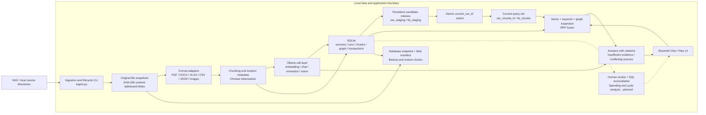
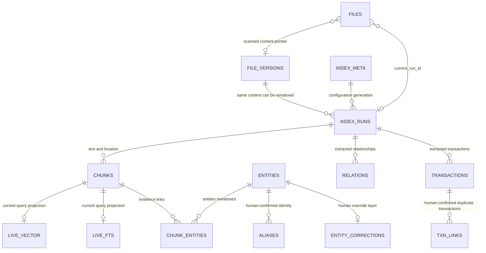
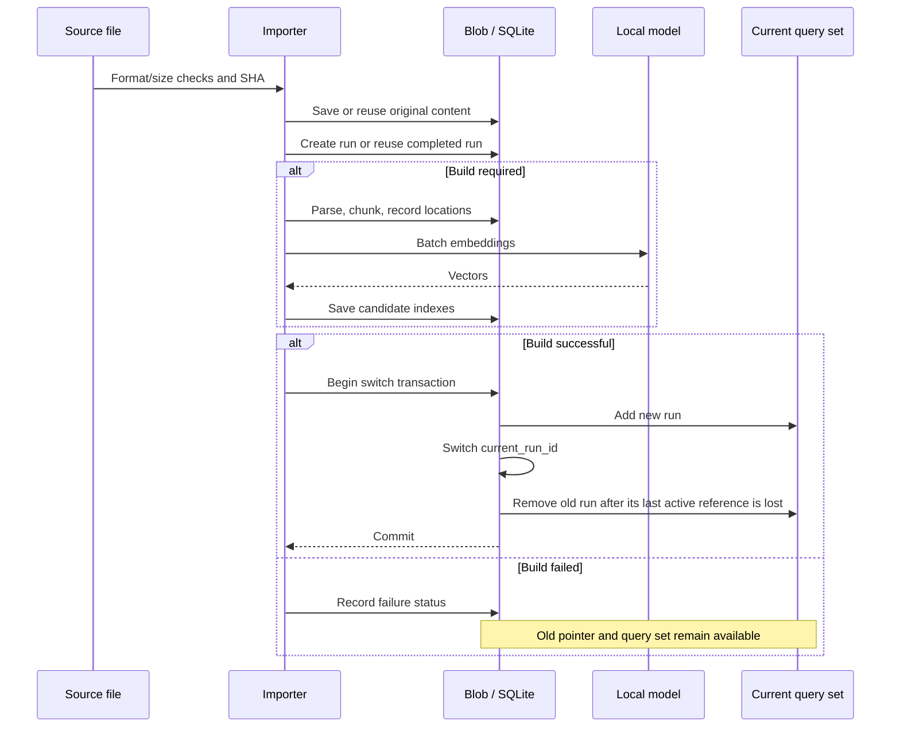

# Family Data RAG

**English** | [简体中文](README.zh-CN.md)

A local data system for family documents, photos, bills, and contracts: preserve original materials, provide traceable search and question answering, and gradually add knowledge relationships, spending reconciliation, and consumption-cycle analysis.

The current implementation is based on local processing: Ollama runs model inference, SQLite stores data and indexes, and a NAS provides source files. Installing dependencies and downloading models requires internet access. **The local processing boundary still needs configuration and verification; using Ollama alone does not guarantee that data stays on the machine.**

## Azure migration planning (2026-11-20)

The new direction is to migrate to Azure to address local compute, vector storage, and OCR quality constraints while preserving data security, cost control, and future portability. This work currently consists of planning documents and diagrams; no Azure resources have been deployed and no family data has been migrated. The local architecture and historical development status below remain references for the existing implementation.

- [Migration design and decision record (Chinese)](docs/architecture/azure-migration-plan.zh-CN.md)
- [Candidate work and acceptance gates (Chinese)](docs/architecture/azure-migration-backlog.zh-CN.md)
- [Editable architecture diagrams: draw.io / Excalidraw](docs/architecture/README.md)

## Development status

This README describes the intended design and distinguishes current code from planned capabilities. Status checked on 2026-10-09 against primary workspace commit `fca6229` and its then-uncommitted changes; Claude Code was developing in parallel. Phase 1 foundation code had been committed, with knowledge graph extraction next. Acceptance testing with real materials and evaluation of model quality are separate activities.

| Capability | Current status | Main files |
| --- | --- | --- |
| Configuration, database schema, index switching | Code and local self-tests available | `config.py`, `db.py` |
| Scanning, deduplication, parsing, chunking, embeddings, removal/cleanup | Implementation in development in the workspace | `ingest.py`, `parsers.py`, `textutil.py` |
| Ollama calls | In development; local endpoint and authentication-header restrictions still need hardening | `models.py` |
| Hybrid retrieval, answers with citations, Chat/Files UI | Implemented; model answer quality and UI still need acceptance testing with real data | `retrieve.py`, `chat.py`, `app.py` |
| Graph extraction, human confirmation and correction | Schema available; business workflow planned | `extract.py` |
| Transaction extraction, monthly reconciliation, forecasting | Schema available; business workflow planned | `spend.py` |
| Backup manifests, restore checks, rebuilding with different dimensions | CLI and synthetic tests available; full concurrency and restore acceptance testing pending | `ingest.py`, `db.py` |
| Local startup and cloud-disabled checks | Implemented; client environment inheritance and listening-interface checks still need hardening | `run.bat`, `run.ps1` |

Passing self-tests only means that the existing synthetic checks passed. See [bench.md](bench.md) for environment measurements and the [security review](docs/security-review.md) for credential scan results and unresolved issues.

## Architecture

Solid lines indicate existing foundation implementations; dashed lines indicate planned connections. The security boundary is a target that must be implemented and verified.



Start with a single SQLite database and ordinary file directories, without a separate graph database, object storage service, or RAG framework. SQLite uses WAL, foreign keys, sqlite-vec, and FTS5; Chinese text uses consistent tokenization during indexing and querying.

## Data model and evidence



- **Separate source from content**: paths identify sources; SHA-256 identifies content. Multiple sources can share a content version and a completed index run.
- **Separate content from indexes**: `file_versions` stores original content; `index_meta` stores the parser, chunking configuration, embedding digest, and dimensions; `index_runs` records a build. Indexes can be rebuilt even when content has not changed.
- **The two pointers serve different purposes**: in the current code, `current_version_id` records content found during scanning; `current_run_id` determines the queryable index. If indexing new content fails, the old index remains available. Citations to original files should resolve through the version associated with the run.
- **Location evidence**: chunks store page numbers/text ranges, worksheets/row ranges, paragraph ranges, or OCR regions. Internal PDF page numbers currently start at 0; the UI should convert them to user-facing page numbers.
- **Human judgment**: matching names only create merge candidates; the existence of a citation and the correctness of a relationship are assessed separately. Human corrections act as query/display overrides and are not overwritten by re-extraction.

Graph data and transactions belong to runs; final queries and statistics are restricted to currently active runs. Current vector tables are named by dimension: `vec_chunks_N` / `vec_staging_N`; configuration generations are recorded separately in `index_meta`. Rebuilds switch one file at a time. If current references span mixed generations, retrieval refuses to run; this does not mean a full database rebuild supports an atomic switch with uninterrupted queries.

## Ingestion, switching, and deletion



Invariants that CI must verify:

1. Candidate runs do not participate in retrieval. Current staging tables also retain persistent indexes for completed runs, allowing them to rejoin the live set when referenced again.
2. When A and B share an old run, updating A must not affect B. Once the last active reference is removed, the old run immediately leaves the query set without waiting for GC.
3. `remove` removes a source; `purge` deletes content and indexes, rejecting content that is still actively referenced or being built.
4. Snapshots and indexes are retained when the NAS is offline or source files disappear. The current database defines active sources as `status != 'removed'`; failed/missing sources with an old `current_run_id` remain queryable.
5. GC, builds, and backups must coordinate. The default backup directory currently has a `backup.lock`; coordination for custom backup directories and the full build lifecycle still needs hardening.

The current blob path is `data/blob/<sha256>.<ext>`, which differs slightly from the planned directory layout. The database stores the actual blob path.

## Retrieval, graph, and spending

Question-answering path: query embedding → current vector top-30 + tokenized full-text top-20 + entity/alias matching → confirmed relationship expansion up to two hops → RRF fusion → evidence within the context budget → local model generates an answer and citations.

Graph expansion is implemented; relationship extraction and human confirmation workflows await Phase 2. Relationship traversal is restricted to confirmed relationships in currently active runs; every candidate must also be in the current query set before fusion. Instructions in documents are data to cite. The current answering model has no tools for executing commands or uploading data. Handling insufficient evidence and conflicting sources is a requirement for answers; actual model compliance needs separate evaluation.

Spending analysis starts with reconciliation, then forecasting: integer amounts with currency scales; distinguish purchases, refunds, transfers, and credit card repayments; deduplicate the same transaction across invoices/statements after human confirmation. SQL/code computes totals and forecasts; the model only explains them. Product replenishment cycles require quantities, units, and line items, and are planned for a later phase.

The photo MVP targets dates, human tags, OCR, and descriptions labeled as AI-generated. Current original file snapshots retain original EXIF, including any GPS data. Not reading GPS does not mean it has been removed from the original image. Image embedding search is not yet implemented.

## Local development and validation

The current baseline is Python 3.14, native Windows, and Ollama. Package versions are defined in `requirements.txt`; run smoke tests after installation.

```powershell
python -m venv .venv
.\.venv\Scripts\python.exe -m pip install -r requirements.txt
Copy-Item config.toml.example config.toml
.\.venv\Scripts\python.exe -m selftest
```

Set source directories, database paths, and blob directories in `config.toml`. Access the NAS through operating system accounts/credential management; do not put passwords in configuration, UNC paths, or example files.

Download models separately first. The default embedding model is `nomic-embed-text`; compare `bge-m3` on mixed Chinese/English samples, then settle on the model and dimensions before full ingestion.

```powershell
ollama pull qwen3:14b
ollama pull qwen3:8b
ollama pull qwen3-vl:8b
ollama pull nomic-embed-text
# Multilingual comparison candidate: ollama pull bge-m3
```

Before ingesting real data, configure the local boundary in a dedicated terminal. Stop existing Ollama instances first, then start the service so the server inherits the configuration.

```powershell
$env:OLLAMA_HOST = '127.0.0.1:11434'
$env:OLLAMA_NO_CLOUD = '1'
$env:OLLAMA_NOHISTORY = '1'
$env:OLLAMA_MAX_LOADED_MODELS = '2'
$env:NO_PROXY = 'localhost,127.0.0.1,::1'
Remove-Item Env:OLLAMA_API_KEY -ErrorAction SilentlyContinue
ollama serve
```

The separate terminal running ingest must also set a local `OLLAMA_HOST` and `NO_PROXY`, and remove any inherited `OLLAMA_API_KEY`. These measures do not replace restrictions in code.

Current workspace CLI (in development):

```powershell
.\.venv\Scripts\python.exe -m ingest --help
.\.venv\Scripts\python.exe -m ingest status
.\.venv\Scripts\python.exe -m ingest scan
.\.venv\Scripts\python.exe -m ingest parse
.\.venv\Scripts\python.exe -m ingest backup
.\.venv\Scripts\python.exe -m ingest restore-test
# Chat / Files UI in development:
.\run.bat
```

`parse` retries files whose current content has not been successfully indexed; `rebuild` reindexes according to configuration. `remove <path>`, `purge <sha256>`, and `gc` modify data. Current CLI initialization probes embedding dimensions and lists models, so `status` / `restore-test` also require local Ollama.

`run.bat` calls `run.ps1`, configures the local environment, checks cloud-disabled status, and starts Streamlit bound to `127.0.0.1:8501`. It may stop existing Ollama instances. Failed checks block startup by default; `--skip-check` bypasses this protection. The launcher does not yet remove inherited API keys, disable proxies, or verify actual listening interfaces.

## Credentials and privacy

Credential files, local configuration, and `data/` are excluded by `.gitignore`. This does not encrypt data, prevent forced additions, or undo previously committed files. Data directories must be separately excluded from operating system cloud synchronization. Original files, databases, vectors, correction records, and backups all require encrypted storage and access control.

[Secret scan CI](.github/workflows/secrets.yml) uses a pinned Gitleaks version to check the working tree and all reachable history, redacts matched values, and does not upload raw reports. Self-test CI uses synthetic data; real materials must not enter code, CI artifacts, or logs.

After installing Gitleaks, recheck history with:

```powershell
gitleaks git . --log-opts="--all --full-history" --redact=100 --no-banner
```

Working tree scans should exclude `.git`, `.venv`, and caches, and check local configuration separately. Do not ignore business code to reduce scan noise.

The 2026-10-09 review found no credential matches in the scanned content, but identified potential leakage through the default SDK's endpoint/API key inheritance and risks from raw exception logging. **No zero-egress guarantee is made until runtime hardening and network verification are complete.** See the [review scope, reproductions, and remediation requirements](docs/security-review.md).

## Roadmap and workflow

| Phase | Deliverables | Acceptance criteria |
| --- | --- | --- |
| Phase 0 | Environment, smoke tests, minimal CI, model benchmarks | Windows import/OCR/vector checks; record actual models and VRAM usage |
| Phase 1 | Reliable ingestion, hybrid retrieval, answers with citations, backup/restore | Shared-reference isolation; failed builds retain old indexes; last-reference removal; restored evidence remains consistent |
| Phase 2 | Evidence-backed graph and human confirmation | No automatic merging of matching names; validity periods and current-run scoping; corrections preserved |
| Phase 3 | Transaction review, full-month reconciliation, spending and cycle analysis | Reconcile and explain differences; duplicate transactions are not counted twice |
| Phase 4 | Product replenishment, photo timeline/visual search, other forecasts | Define data and accuracy requirements for each specific need |

Follow [AGENTS.md](AGENTS.md): after the initial commit, work on task branches, use Release Please-compatible Conventional Commits, commit small and complete changes frequently, and merge into `main` through PRs and CI.
