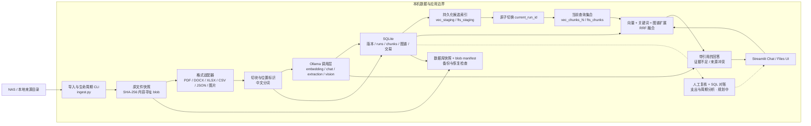
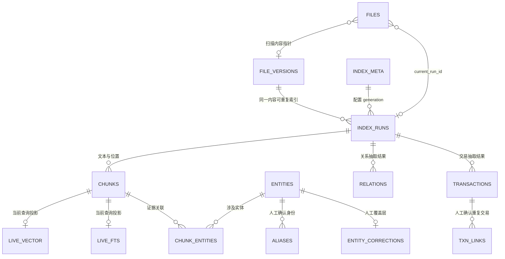
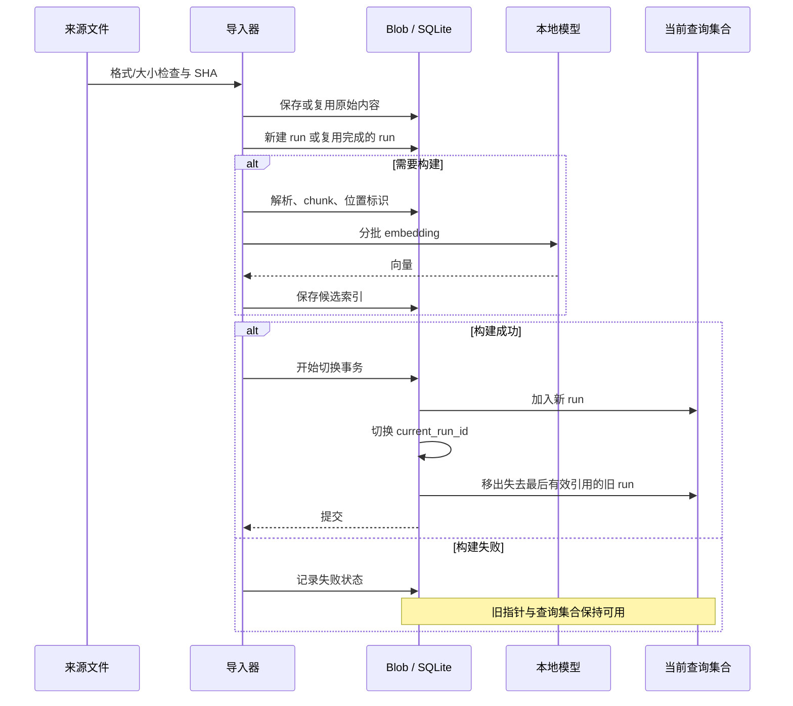

# Family Data RAG

面向家庭文档、照片、账单与合同的本地数据系统：保存原始材料，提供可追溯的检索和问答，再逐步增加知识关系、支出对账与消费周期分析。

设计目标是本机处理：Ollama 提供模型推理，SQLite 保存数据和索引，NAS 作为文件来源。安装依赖与下载模型需要联网。**本地运行边界仍需配置和验证，不能仅凭使用 Ollama 就认为数据不会外传。**

## 开发状态

本 README 描述最终设计，并区分当前代码与后续能力。状态核对日期：2026-10-09，主工作区提交 `69cf48e` 及当时未提交变更；Claude Code 正在并行开发。

| 能力 | 当前状态 | 主要文件 |
| --- | --- | --- |
| 配置、数据库 schema、索引切换 | 已有代码和本地自检 | `config.py`、`db.py` |
| 扫描、去重、解析、切块、embedding、移除/清理 | 工作区已有开发中实现 | `ingest.py`、`parsers.py`、`textutil.py` |
| Ollama 调用 | 开发中；本地端点与认证头限制尚需加固 | `models.py` |
| 混合检索、引用问答、Chat/Files UI | 已有实现；模型回答质量与 UI 尚需真实数据验收 | `retrieve.py`、`chat.py`、`app.py` |
| 图谱抽取、人工确认与纠正 | 已有 schema，业务流程规划中 | `extract.py` |
| 交易抽取、月度对账、预测 | 已有 schema，业务流程规划中 | `spend.py` |
| 备份清单、恢复检查、不同维度重建 | 已有 CLI 和合成测试；完整并发与恢复验收待完成 | `ingest.py`、`db.py` |
| 本地启动与 cloud-disabled 检查 | 已有实现；客户端继承与监听接口检查待加固 | `run.bat`、`run.ps1` |

自检通过只表示现有合成样本检查通过。环境测量见 [bench.md](bench.md)；凭据检查结果和未关闭问题见 [安全审查记录](docs/security-review.md)。

## 整体架构

实线表示当前已有基础实现；虚线表示后续规划连接。安全边界是需要实现并验证的目标。



先采用单个 SQLite 数据库与普通文件目录，不引入独立图数据库、对象存储服务或 RAG 框架。SQLite 使用 WAL、外键、sqlite-vec 和 FTS5；中文文本在索引和查询时采用一致分词。

## 数据模型与证据



- **来源与内容分离**：路径标识来源；SHA-256 标识内容。多个来源可以共享内容版本与完成的索引 run。
- **内容与索引分离**：`file_versions` 保存原始内容；`index_meta` 保存解析器、切块、embedding digest 和维度；`index_runs` 记录一次构建。内容不变也能重建索引。
- **两个指针不同**：当前代码的 `current_version_id` 记录扫描发现的内容；`current_run_id` 决定可查询索引。新内容失败时旧索引继续可用；引用原文件应从 run 关联的版本取得。
- **位置证据**：chunk 保存页码/文本范围、工作表/行范围、段落范围或 OCR 区域。内部 PDF 页号当前从 0 开始，UI 应转换为用户页号。
- **人工判断**：同名只产生合并候选；引用存在与关系正确分别判断。人工纠正作为查询/展示覆盖层，不被重新抽取覆盖。

图谱与交易归属于 run，最终查询和统计都限制到当前有效 run。当前向量表按维度命名：`vec_chunks_N` / `vec_staging_N`；配置 generation 另由 `index_meta` 记录。重建逐文件切换；如果当前引用混合 generation，检索会拒绝执行，不代表全库重建具备不中断查询的原子切换。

## 导入、切换与删除



必须由 CI 验证的约束：

1. 候选 run 不参与检索。当前 staging 表也保存完成 run 的持久索引，便于再次引用时重新加入 live 集合。
2. A、B 共享旧 run 时，A 更新不能影响 B；最后一个有效引用移除时，旧 run 立即退出查询，无需等待 GC。
3. `remove` 移除来源；`purge` 删除内容和索引，拒绝仍被有效引用或正在构建的内容。
4. NAS 离线/源文件消失时保留快照与索引。当前数据库以 `status != 'removed'` 定义有效来源；有旧 `current_run_id` 的失败/缺失来源仍可查询。
5. GC、构建和备份必须协调。当前默认备份目录有 `backup.lock`；自定义备份目录与完整构建周期的并发协调仍需加固。

当前 blob 路径是 `data/blob/<sha256>.<ext>`，与计划中的目录布局略有不同；数据库保存实际 blob 路径。

## 检索、图谱与支出

问答路径：query embedding → 当前向量 top-30 + 分词后全文 top-20 + 实体/别名匹配 → 最多两跳的已确认关系扩展 → RRF 融合 → 上下文预算内的证据 → 本地模型生成答案和引用。

图谱扩展实现已存在，关系抽取与人工确认流程尚待 Phase 2。关系遍历限制到当前有效 run 的已确认关系；所有候选还需保证在融合前处于当前查询集合。文档中的指令是待引用的数据，当前回答模型不获得执行命令或上传工具。证据不足与来源冲突是回答要求，实际模型遵从程度需单独评测。

支出分析先对账，再预测：整数金额加币种 scale；区分消费、退款、转账与信用卡还款；发票/流水中的同一交易经人工确认去重。汇总和预测由 SQL/代码计算，模型只解释。商品补货周期需要数量、单位与明细，安排在后续阶段。

照片 MVP 目标是日期、人工标签、OCR 与标记为 AI 生成的描述。当前原文件快照保留原始 EXIF，包括可能存在的 GPS；不读取 GPS 不代表原图已去除 GPS。图像 embedding 搜索尚未实现。

## 本地开发与验证

当前基线是 Python 3.14、原生 Windows 和 Ollama。包版本以 `requirements.txt` 为准，安装后运行 smoke tests。

```powershell
python -m venv .venv
.\.venv\Scripts\python.exe -m pip install -r requirements.txt
Copy-Item config.toml.example config.toml
.\.venv\Scripts\python.exe -m selftest
```

在 `config.toml` 填入来源目录、数据库与 blob 目录。NAS 使用操作系统账户/凭据管理；不要将密码放进配置、UNC 路径或示例文件。

模型先单独下载。默认 embedding 为 `nomic-embed-text`；中英混合样本应比较 `bge-m3`，确定模型和维度后再完整导入。

```powershell
ollama pull qwen3:14b
ollama pull qwen3:8b
ollama pull qwen3-vl:8b
ollama pull nomic-embed-text
# 多语言对比候选：ollama pull bge-m3
```

实际导入前，在专用终端设置本地边界；先退出已有 Ollama 实例，再启动服务，使服务器继承配置。

```powershell
$env:OLLAMA_HOST = '127.0.0.1:11434'
$env:OLLAMA_NO_CLOUD = '1'
$env:OLLAMA_NOHISTORY = '1'
$env:OLLAMA_MAX_LOADED_MODELS = '2'
$env:NO_PROXY = 'localhost,127.0.0.1,::1'
Remove-Item Env:OLLAMA_API_KEY -ErrorAction SilentlyContinue
ollama serve
```

运行 ingest 的另一个终端也要设置本地 `OLLAMA_HOST`、`NO_PROXY`，并移除继承的 `OLLAMA_API_KEY`。这些措施不替代代码层限制。

当前工作区 CLI（开发中）：

```powershell
.\.venv\Scripts\python.exe -m ingest --help
.\.venv\Scripts\python.exe -m ingest status
.\.venv\Scripts\python.exe -m ingest scan
.\.venv\Scripts\python.exe -m ingest parse
.\.venv\Scripts\python.exe -m ingest backup
.\.venv\Scripts\python.exe -m ingest restore-test
# 开发中的 Chat / Files UI：
.\run.bat
```

`parse` 重试未成功索引当前内容的文件；`rebuild` 根据配置重新索引；`remove <path>`、`purge <sha256>`、`gc` 会修改数据。当前 CLI 初始化调用 embedding 维度探测和模型列表，所以 `status` / `restore-test` 也需要本地 Ollama。

`run.bat` 调用 `run.ps1`，设置本地环境并检查 cloud-disabled 状态，然后启动绑定 `127.0.0.1:8501` 的 Streamlit。它可能停止现有 Ollama 实例；检查失败默认拒绝继续，`--skip-check` 会绕过此保护。启动器尚未清除继承的 API key、禁用代理或验证实际监听接口。

## 凭据与隐私保护

凭据文件、本地配置和 `data/` 由 `.gitignore` 排除；这不等于加密、不阻止强制添加，也不会撤销已提交文件。操作系统云同步需单独排除数据目录。原文件、数据库、向量、纠正记录和备份均需加密存储与访问控制。

[Secret scan CI](.github/workflows/secrets.yml) 使用固定版本 Gitleaks 检查工作树和完整可达历史，输出隐藏匹配值，不上传原始报告。自检 CI 使用合成数据；真实资料不得进入代码、CI artifacts 或日志。

安装 Gitleaks 后可复查历史：

```powershell
gitleaks git . --log-opts="--all --full-history" --redact=100 --no-banner
```

工作区扫描需排除 `.git`、`.venv` 和缓存，另检查本地配置；不要为排除噪声忽略业务代码。

2026-10-09 审查未发现已扫描内容中的凭据匹配，但发现默认 SDK 继承端点/API key 的潜在泄露路径，以及原始异常日志风险。**运行时加固和网络验证完成前，不承诺零外传。** 见 [审查范围、复现与修复要求](docs/security-review.md)。

## 路线图与工作流

| 阶段 | 交付 | 验收 |
| --- | --- | --- |
| Phase 0 | 环境、smoke tests、最小 CI、模型基准 | Windows 导入/OCR/向量检查，记录实际模型与显存 |
| Phase 1 | 可靠导入、混合检索、引用问答、备份恢复 | 共享引用隔离、失败保留旧索引、最后引用移出、恢复证据一致 |
| Phase 2 | 有证据的图谱与人工确认 | 同名不自动合并、有效期与当前 run 范围、纠正保留 |
| Phase 3 | 交易复核、整月对账、支出与周期分析 | 对账并解释差额，重复交易不重复计入 |
| Phase 4 | 商品补货、照片时间线/视觉搜索、其他预测 | 按具体需求定义数据与准确性要求 |

遵守 [AGENTS.md](AGENTS.md)：初始提交之后在任务分支工作，使用 Release Please 兼容的 Conventional Commits，频繁提交小而完整的变更，通过 PR 和 CI 合并到 `main`。
