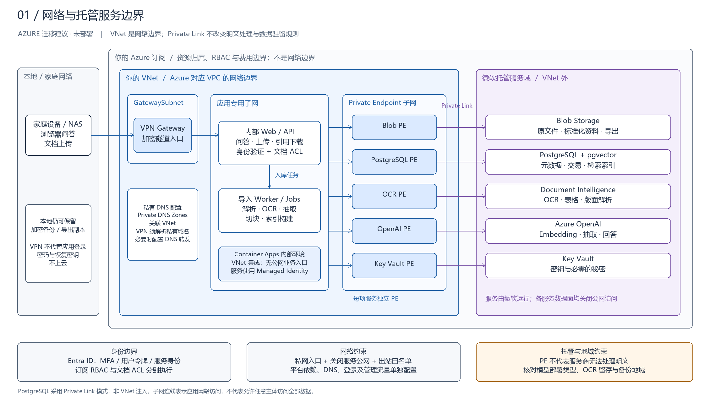
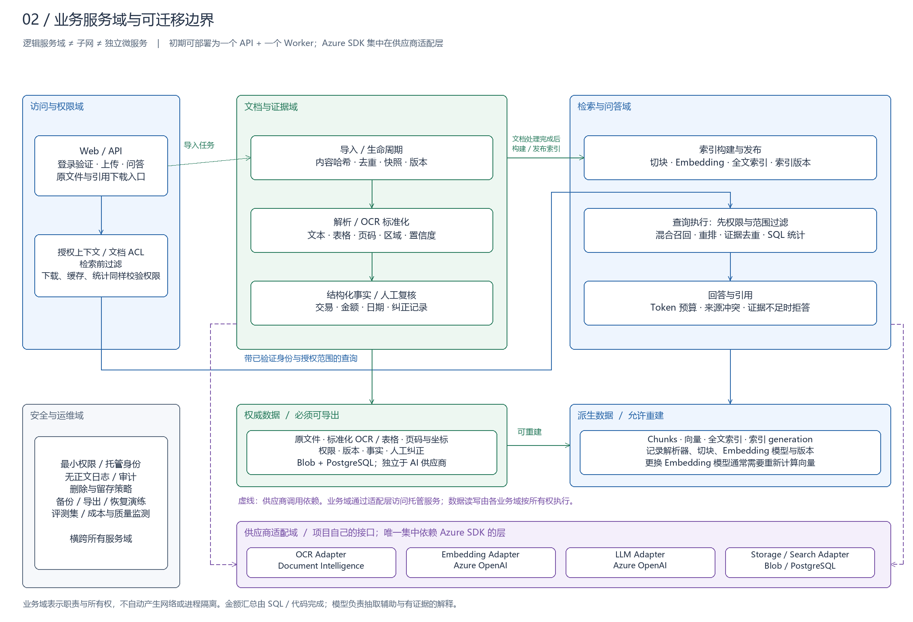

# Azure 架构草案：可编辑图

这是迁移设计草案，不代表已经部署或验证了任何 Azure 安全配置。图中不含家庭资料、真实端点、凭据或订阅标识。

## 迁移文档与后续工作

- [Azure 迁移设计与决策记录](azure-migration-plan.zh-CN.md)：目标、安全 / 网络 / 托管边界、准确性与成本、可迁移原则、未决事项。
- [Azure 迁移待办与验收](azure-migration-backlog.zh-CN.md)：候选任务 AZ-001～AZ-026、依赖、阶段门槛与验收要求。

整理日期为 2026-11-20；清单中的云端能力仍待实施。文档和架构图完成不代表相关安全、质量或迁移验收已经通过。

## 打开与编辑

| 工具 | 文件 | 内容 |
| --- | --- | --- |
| draw.io / diagrams.net | [azure-architecture.drawio](azure-architecture.drawio) | 两个页面：网络边界、业务服务域 |
| Excalidraw | [01-network-boundaries.excalidraw](01-network-boundaries.excalidraw) | 网络与微软托管服务边界 |
| Excalidraw | [02-service-domains.excalidraw](02-service-domains.excalidraw) | 业务职责、权威数据、派生索引、供应商适配层 |

在相应编辑器中使用打开本地文件功能，或把原生文件拖入编辑器。draw.io 文件的两个页面可通过底部页签切换。初次打开可以使用适合画布的缩放。

这些原生文件包含可编辑的矩形、文字与绑定到节点的连接线，没有把整张图嵌入为图片。draw.io 还保留了容器与子节点关系；Excalidraw 的边界框和标题成组，内部节点可单独移动。连线旁的说明文字是独立可编辑元素，调整布局后可能需要随之移动。

PNG 是便于阅读的预览，SVG 是矢量参考；继续编辑架构请使用 `.drawio` 或 `.excalidraw`。两种原生格式是同一份初版设计的独立副本，之后的手工修改不会自动相互同步。

## 图的含义

1. 网络图采用家庭设备 / NAS → VPN → VNet 集成的内部 Container Apps 环境 → 独立 Private Endpoint → Azure 托管服务的路径。
2. Private Endpoint 在客户 VNet 内；Blob、OCR、OpenAI、Key Vault 和本方案采用 Private Link 模式的 PostgreSQL 仍属于微软托管服务域。不要将该模式与 PostgreSQL VNet 注入混为一谈。
3. Azure 订阅是资源归属和权限管理边界，不是网络隔离或数据处理地域的保证。私网连接也不代表服务商不能处理明文。
4. 图中的关闭公网、MFA、Managed Identity、文档 ACL、出站白名单、私有 DNS、留存清理与恢复演练均为需要实施及验收的设计约束。
5. 私有 DNS 文本框是配置说明，不表示 Private DNS Zones 本身部署在子网中。VPN DNS 转发、平台必需的出站依赖、身份和管理流量需要在实施时细化。
6. 网络图中应用子网连线表示网络访问关系；不代表每个进程或主体都被授予访问全部服务的权限。
7. 业务服务域是逻辑职责边界，不要求拆成多个微服务、子网或数据库。初期可以是一个 API 和一个 Worker。
8. 权威资料必须可导出；向量与搜索索引必须能重建。更换 embedding 模型通常需要重新计算向量。

## 预览





## 初版生成与校验

`generate_diagrams.py` 是初版图的可重复生成源，不是原生文件的双向编辑器。直接编辑原生图后，请先备份；再次运行生成器会覆盖生成的文件。

只生成 Excalidraw、draw.io 和 SVG，使用 Python 标准库即可：

```powershell
python docs/architecture/generate_diagrams.py
```

同时生成 PNG 预览，使用项目已有的 Pillow 和本机中文字体：

```powershell
python docs/architecture/generate_diagrams.py --png
# 其他系统可用 --font 指定中文字体的绝对路径。
```

交付前已检查 JSON/XML 可解析性、唯一元素 ID、连接线双端引用、文本容器引用、draw.io 父子关系、图形范围与中文字宽，并逐张查看 PNG 排版。draw.io 文件另通过官方 `mxfile.xsd` 校验。未在 Excalidraw 或 draw.io 编辑器中实际导入操作；PNG 预览由同一布局定义生成，不是编辑器导出的截图。

## 格式与网络参考

- [Excalidraw JSON 格式](https://docs.excalidraw.com/docs/codebase/json-schema)
- [Excalidraw 元素恢复与绑定修复](https://docs.excalidraw.com/docs/@excalidraw/excalidraw/api/utils/restore)
- [draw.io 原生 XML 格式与校验](https://www.drawio.com/docs/reference/diagram-generation/)
- [Azure Private Endpoint](https://learn.microsoft.com/en-us/azure/private-link/private-endpoint-overview)
- [Container Apps 网络](https://learn.microsoft.com/en-us/azure/container-apps/networking)
- [PostgreSQL Private Link](https://learn.microsoft.com/en-us/azure/postgresql/network/concepts-networking-private-link)
